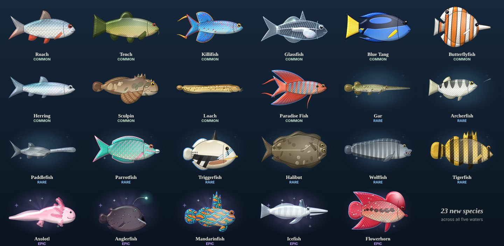
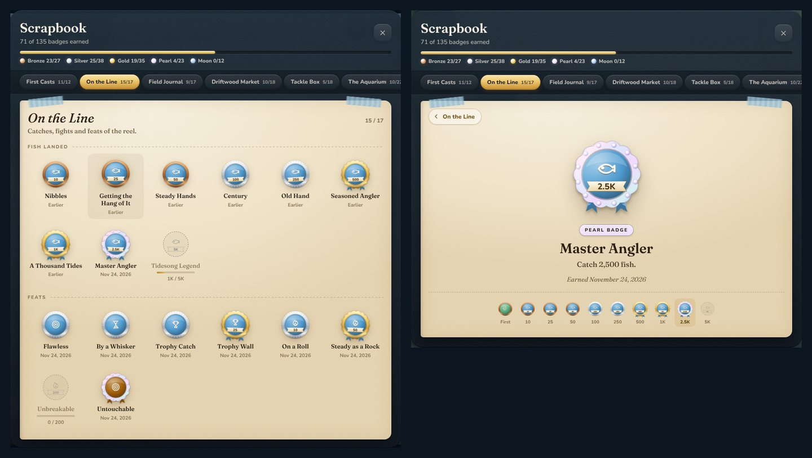

# Tidesong Fishing

A calm, hand-crafted fishing game for phone and desktop browsers. Cast into five enchanted waters,
wait for a bite, then hold to keep the gold fish marker inside your green band until the ring fills.


- **No build step, no server, no assets.** Open `index.html` and play. Every fish, rod and lake is
  drawn in code, and every sound is synthesised with the Web Audio API.
- **58 species** across five waters, from a pond Bluegill to a Bottlenose Dolphin and the elusive
  Dragon Fish.
- **WebGL water and lighting** with reflections, ripples, bloom and god rays, plus a 2D fallback for
  devices without WebGL.
- **A market of 88 pieces of gear** in seven themes on one tier ladder. Every tier offers several
  styles at the same price and boost, up to Heirloom pieces that take a whole career to save for.
- **A living aquarium** for the fish you keep: six tanks from a glass bowl to a moonlit palace, all
  kept as you buy them, where fish explore, meet, make friends and sometimes mates, and every one of
  them slowly makes pearls.
- **135 badges in a scrapbook**, from the first fish to a full Moon Palace, in five grades from bronze
  to moon, with secrets to find.
- **Progress saves automatically** in the browser.

## Contents

- [Playing](#playing)
- [How a catch works](#how-a-catch-works)
- [The five waters](#the-five-waters)
- [The fish](#the-fish)
- [The Driftwood Market](#the-driftwood-market)
- [The aquarium](#the-aquarium)
- [Badges and the scrapbook](#badges-and-the-scrapbook)
- [Graphics](#graphics)
- [Sound](#sound)
- [Project structure](#project-structure)
- [Tuning the game](#tuning-the-game)
- [Testing shortcuts](#testing-shortcuts)
- [Browser support](#browser-support)

## Playing

Open `index.html` in a modern browser. That's it: there is nothing to install or build.

To serve it locally instead (handy for testing on a phone on the same network):

```bash
python3 -m http.server 8000
```

Then visit `http://localhost:8000`.

| Action | Desktop | Phone |
| --- | --- | --- |
| Cast | Click the water where you'd like the bobber to land, or press Space for a cast wherever it goes | Tap the water where you'd like it to land |
| Push the green band right | Hold the mouse button or Space | Hold anywhere |
| Let the band drift left | Release | Lift your finger |

## How a catch works

1. **Cast.** Tap or click where you'd like the float to land. A tap beyond the line's reach (on the
   sky, the dock, or water too near or too far) casts as far or as near as it can toward that spot.
   With a mouse, a faint ring on the water shows where a click would land; once cast, the float falls
   into a ring at that spot. Space casts wherever the cast happens to go: somewhere a little different
   each time. A longer cast flies longer and higher. If the float comes down on something in the water
   (a lily pad, an ice floe, a lantern post, a floating lantern), it strikes it with a thud in that
   thing's own voice. The thing dips and rocks, and the float bounces, slides or drops off into the
   water beside it.
2. **Wait.** Shadows of fish drift under the surface: a few at a time, rising into view, cruising and
   sinking away again. Each is the size of a real fish, so a big shadow is a big fish. When the float
   lands, fish nearby turn to look and circle it, while one right under it bolts. The fish that bites
   circles closest and noses in on nibbles before it strikes; it might be one of the lookers, or one
   that rises from the deep to join them. Bites come on a rolling chance that grows the longer the line
   sits, once that fish has arrived. On the bite, a brass medallion with an engraved "!" springs up
   over the float with a burst of light. The meter sweeps into place beneath it: the ring spins up,
   the track opens out from the middle, the band grows in and the gold line drops into place. Then the
   medallion flies down into the ring, so the meter has settled by the time you take control. The
   timing of the fight is unchanged.
3. **Fight.** A slider appears with a gold line (the fish) and a green band (your control). Hold to
   push the band right and release to let it drift left. While the gold line is inside the band, the
   ring fills. When it is outside, the ring drains. Fill the ring to land the fish. If it drops
   below the red mark, the fish gets away. The gold line moves like something alive: it leaves a short
   wake when it darts, leans into a dash and swings back as it brakes, sends a faint ripple from
   where it kicks off hard, and breathes when it holds still. Inside your band it warms, glowing and
   giving off sparks, with a pulse of light on each step the ring fills; outside it cools back to plain
   gold. All of this follows how the line actually moves, so a calm fish looks calm and a wild one
   looks wild, without giving its rarity away.
4. **Keep, sell or release.** Every catch has a weight, a length and a price.

A bite never announces its rarity: the cue and the slider look the same for every fish, and a shadow
shows only how big a fish is (a big carp and a small legend can look alike). You learn what you have
hooked from how hard it fights. Rarer fish move faster, change direction
more often, dart across the slider and thrash in place.

| Rarity | XP | Base price | How it fights |
| --- | --- | --- | --- |
| Common | 10 | 12 | Steady, with long pauses |
| Rare | 28 | 45 | Quicker, with the odd dash |
| Epic | 75 | 160 | Darts and thrashes |
| Legendary | 320 | 1,200 | Fast and erratic |
| Extreme | 1,200 | 5,000 | Relentless |

The first catch of each species earns a discovery bonus.

### Shadows and where you cast

Where you cast never changes what you catch. The fish that will bite is rolled with the water's
usual odds (and your bait) the moment the float lands, exactly as a bite always was, with its weight
and length too. The shadows only play it out:

- **Sizes are real.** Every passing shadow is the size of a fish rolled with the same odds, so the
  shadows show what lives in that water: mostly small and middling fish, now and then a big one. A
  shadow's length follows the fish's length, from a small fish's sliver to a dolphin's broad shape.
- **The fish that bites is shown faithfully.** If a looker is about the size of the fish that will
  bite, that looker is the one that takes the float. Otherwise a fish of the right size comes up from
  the deep to join them. Casting beside a big shadow can hook a big fish, but only when the roll says
  so. A big shadow that circles and swims off was a fish that didn't bite.
- **Placement changes how soon, not what.** Landing near fish (but not on one) draws lookers, and the
  bite comes sooner, about 15% sooner on average. Landing right on top of a fish scares it and its
  neighbours off, and the bite comes about 10% later. A cast with no fish nearby waits as long as a
  cast always did (measured over hundreds of casts at Mistwillow Pond: 5.3 s against 5.2 s before). Over a whole catch (cast, wait, fight and reveal), good aim saves only a few percent
  of the time, so the economy is unchanged.

The shadows live in `js/game.js` under "The fish below" (`SHOAL`, `stirShoal()`, `newcomer()`), and
WebGL draws up to six at once (`MAX_FISH` in `js/water-gl.js`).

## The five waters

Each water opens at a fishing level and has its own fish, odds, light, sounds and rare moments: a
frog hopping onto a lily pad, a gull sweeping past, dolphins leaping past the reef, a whale breaching
under the aurora.


| Water | Opens at | Time of day | Rarity odds per bite |
| --- | --- | --- | --- |
| Mistwillow Pond | Level 1 | Early morning | Common 87%, Rare 11%, Epic 2% |
| Lanternfen Marsh | Level 3 | Dusk | Common 78%, Rare 18%, Epic 4% |
| Coralspire Lagoon | Level 6 | Golden afternoon | Common 64%, Rare 26%, Epic 8.7%, Legendary 1.3% |
| Frostveil Fjord | Level 10 | Aurora night | Common 60%, Rare 27%, Epic 11%, Legendary 2% |
| Dragonmere Sanctum | Level 15 | Crimson moon | Common 52%, Rare 30%, Epic 14.6%, Legendary 2.8%, Extreme 0.6% |

## The fish

Fifty-eight species: 26 Common, 17 Rare, 12 Epic, 2 Legendary and 1 Extreme. Every water has its own
signature fish, and each species bites most often at its home water, so completing the journal means
fishing all five. The journal shows a silhouette of every fish you have not caught yet, with the
water where your odds are best.

| Water | Signature fish |
| --- | --- |
| Mistwillow Pond | Bluegill, Perch, Roach, Tench, Largemouth Bass, Longnose Gar, Angelfish, **Axolotl** |
| Lanternfen Marsh | Mudskipper, Lanternfish, Lyretail Killifish, Ghost Glassfish, Glowfen Eel, Archerfish, Paddlefish, Betta, **Anglerfish** |
| Coralspire Lagoon | Clownfish, Red Snapper, Blue Tang, Copperband Butterflyfish, Lionfish, Queen Parrotfish, Picasso Triggerfish, Golden Seahorse, Mandarinfish, **Dolphin** (Legendary) |
| Frostveil Fjord | Cod, Arctic Char, Herring, Sculpin, Sturgeon, Halibut, Wolffish, Oarfish, Crystal Icefish, **Penguin** (Legendary) |
| Dragonmere Sanctum | Temple Goldfish, Dojo Loach, Paradise Fish, Snakehead, Siamese Tigerfish, Swordfish, Flowerhorn, **Dragon Fish** (Extreme) |

Most signature fish are found only in their home water. You can fish your way through the five waters
quickly, but every one of them keeps something you will have missed, so the journal keeps calling you
back. On the map, each water's card lists its fish, with the ones you have not caught yet shown as "???".

<details>
<summary>All 58 species by rarity</summary>

| Rarity | Species |
| --- | --- |
| Common | Trout, Salmon, Pomfret, Catfish, Crucian, Tilapia, Carp, Bluegill, Perch, Roach, Tench, Mudskipper, Lanternfish, Killifish (Lyretail), Glassfish (Ghost), Clownfish, Red Snapper, Blue Tang, Butterflyfish (Copperband), Cod, Arctic Char, Herring, Sculpin, Goldfish, Loach (Dojo), Paradise Fish |
| Rare | Pufferfish, Grouper, Pike, Barracuda, Bass, Gar (Longnose), Eel, Archerfish, Paddlefish, Lionfish, Parrotfish (Queen), Triggerfish (Picasso), Sturgeon, Halibut, Wolffish, Snakehead, Tigerfish (Siamese) |
| Epic | Koi, Flying Fish (Sting Ray), Angelfish, Axolotl, Betta, Anglerfish, Seahorse, Mandarinfish, Oarfish, Icefish (Crystal), Swordfish, Flowerhorn |
| Legendary | Penguin (Emperor), Dolphin (Bottlenose) |
| Extreme | Dragon Fish (Arowana) |

</details>

Detail grows with rarity. Commons are clean and simple, rares gain fin rays and patterning, epics
gain flowing animated fins, and the Legendary and Extreme catches get the full treatment.



## The Driftwood Market

Sell fish for **Moonpearls** (the price grows with rarity, weight and length), either straight from
the catch screen or later from your aquarium, and spend them on:

- **Bait:** Glow Worms, Moon Shrimp and Ember Roe. One is used up on each bite. Bait tilts the odds
  toward Epic, Legendary and Extreme fish and brings bites sooner, but never guarantees them.
- **Rods, bobbers and lines:** 27 rods, 31 bobbers and 28 lines in seven themes (Classic, Cosmic,
  Blossom, Critters, Beach, Mountain and Bakery), from a dog-leash line and a French Bulldog float
  to a baguette rod with a wheel of brie for a reel. Each slot helps a different part of the fight:
  - **Rods** widen the green band.
  - **Bobbers** make the ring fill faster while the fish is in the band.
  - **Lines** slow the ring's drain when it slips out.
- **Aquariums:** six tanks, bought in order. Every tank you buy is kept and adds its room to the
  others, from 8 fish with the first up to 80 with all six, and each is more elaborate than the last
  (see [The aquarium](#the-aquarium)). When every tank is full, keeping a new fish means selling or
  releasing one first.

Star a fish to protect it from "Sell all unstarred". Legendary and Extreme catches are starred
automatically.
The journal keeps lifetime records (counts, heaviest, longest, most valuable, rarest) even after
fish are sold.

### Gear tiers

All gear sits on one tier ladder shared by the three slots. Every piece on a tier costs the same and
gives the same boost, and most themes appear on most tiers. Every theme has a piece on
Tier V, so you can dress your kit in cosmic, bakery or critters style without giving anything up.
You can skip tiers, and a new piece is equipped straight away unless it is a step down from what you
already have on.

| Tier | Boost | Price | Choice of styles |
| --- | --- | --- | --- |
| Starter | none | free | Willow Switch, Classic Float, Clear Mono |
| Tier I | 2.5% | 250 | 4 rods, 5 bobbers, 5 lines |
| Tier II | 5% | 750 | 4 rods, 5 bobbers, 4 lines |
| Tier III | 7.5% | 2,000 | 4 rods, 5 bobbers, 4 lines |
| Tier IV | 10% | 5,000 | 4 rods, 5 bobbers, 4 lines |
| Tier V | 12.5% | 12,000 | 7 rods, 7 bobbers, 7 lines: one in every theme |
| Heirloom I | 15% | 36,000, from level 18 | Enchanted Rose, Grand Gâteau, Summit Rope |
| Heirloom II | 17.5% | 55,000, from level 22 | Trident of the Tides, Diamond Tiara, Diamond Leash |
| Heirloom III | 20% | 80,000, from level 26 | Event Horizon, Galaxy Orb, Constellation Thread |

The ladder and the Legendary and Extreme fights were tuned together in a simulation of whole
careers, with three models of human play (casual, steady and focused):

- The first upgrade comes within minutes, and early on a new piece is affordable every 5 to 15 minutes.
- For a steady player, Tier V in every slot takes about six and a half hours, and the Heirlooms are
  the long goal after that.
- Each tier makes common fights shorter and lifts the odds on the hardest fish. A steady player lands
  a Legendary about half the time with Tier II in every slot, and nearly every time from Tier IV.
- The Dragon Fish is the real test. A steady player lands it about a quarter of the time with a full
  Tier V kit and two thirds of the time with Heirloom I. Only a full Heirloom III kit makes it close
  to certain, and a casual player still finds it a challenge even then.

The aquariums' pearls, sizes and prices were tuned the same way, over thirty days of real time for
players who fish for 30 minutes, an hour or two hours a day and look in two to four times a day:

- Fishing always pays far better than waiting. Late in the game all six tanks full of trophies make
  about 1,500 to 2,000 pearls an hour against 9,000 to 21,000 an hour from fishing, and a night's
  pearls are worth about an hour of a steady player's fishing.
- Keeping every tank changed how many fish a player can farm, so it was rebalanced as a whole: the
  later tanks are smaller than when only one was kept (6 tanks holding 80 fish in all, not one of
  48), each makes about a fifth fewer pearls per fish, and tanks cost as much as the gear tier of the
  same rank. Every milestone landed within a day of where it was before tanks were kept (within half
  a day for steady and focused players).
- A player who keeps their best fish and sells some when an upgrade is in reach gets through the gear
  ladder about a fifth faster than one who sells everything (a steady player reaches Heirloom II on
  day 16 instead of day 21). After the first few days the tank brings a steady player about a quarter
  to two fifths of their pearls.
- Rarer fish earn more for their slot, but commoner fish earn back their sale price sooner (an Epic
  in about a day of making, a Legendary in about two). So selling a trophy for an upgrade now and
  keeping it for its pearls are both good choices, and which is better depends on what you are saving
  for.

<p>
  
  
</p>

## The aquarium

Fish you keep live in your aquariums, opened from the bowl button under the place name. Tap a fish to
follow it with a card showing its weight, length, temperament and friendships, and to star, sell,
move or release it. **List** shows the tank's fish, most valuable first; **Sell unstarred** clears
out the rest; and **Feed** (once every 30 seconds) sprinkles food: ragged flakes in the usual mix of colours
that float a while, then tumble down, and a few pellets that sink straight to the bottom-dwellers.
Each fish noses up to a morsel and snaps it up: it is sucked into its mouth, crumbs drift away and
the fish chews. A big flake can take two bites.

Fish swim with their whole bodies. Each species is painted in eight frames through a stroke, its
fins swinging from their roots and its tail flicking, and as it swims the body bends along a wave
that runs from a steady head to a sweeping tail (eels ripple along their whole length). The stroke
quickens and deepens as a fish speeds up, turns or lunges, small fish beat faster than big ones, a
fish holding still keeps sculling, and one climbing or diving arches into it. Fish are sized by
their own length: a 9 cm fish is about half the length of a 36 cm one, and the very largest are
gently scaled down so they still fit.

**Every tank you buy is kept.** Each new tank adds its room to the ones you have, and fish move freely
between them:

- **Tabs** above the tank switch between your tanks. Each shows how full it is, and a pearl when
  pearls wait on its sand (gold when its sand is full). The aquarium opens on the tank you last looked
  at, unless another tank's sand is full.
- **Move** (on a fish's card, or beside it in the list) opens a small panel of your other tanks. A
  tank with room takes the fish at once. A full one opens to show its fish, and picking one swaps the
  two. The fish swims up and out, and drops in from above when you next look in on its new tank.
- **All fish** lists every fish tank by tank, with a Visit link for each, and its sell button sells
  the unstarred fish in every tank. In a single tank it only sells that tank's.
- **A new catch you keep** goes to the tank on screen (or last looked at) if it has room, and
  otherwise to the newest tank with room.
- **Friends and mates keep their bond** in different tanks, but bonds only grow while fish share a
  tank. A fish whose mate or best friend lives elsewhere misses them: its card says so, it now and
  then drifts to the side glass to look out, and mates lose their pearl bonus while apart. Bring them
  back together and they greet each other with a dance.
- Saves from before tanks were kept move over on their own: every fish is given a home, the most
  valuable in the newest tank, mates together, and pearls on the old sand stay with them.

| Tank | Fish | Price | What is in it |
| --- | --- | --- | --- |
| Glass Bowl | 8 | free | A round bowl on a windowsill at night: coloured glass pebbles and a sprig of green |
| Reed Tank | +10 | 250 | Swaying reeds, a hollow mossy log, an air stone and a snail crawling on the sand |
| Lily Garden | +12 | 750 | Lily pads and lotus overhead, a frog, a driftwood arch, rolling moss balls, a visiting dragonfly |
| Coral Reef | +14 | 2,000 | Branching corals, a sea fan, an anemone, a giant clam and a treasure chest, under bright sunbeams |
| Shipwreck Cove | +16 | 5,000 | A sunken ship in a kelp forest, a ship's bell, portholes, an anchor and a diver's helmet that breathes bubbles |
| Moon Palace | +20 | 12,000 | A moon gate, a stone dragon blowing bubble rings, lantern plants, singing geodes, glowing sand and floating lanterns |


The game explains almost none of what follows; players find it by watching and touching.

- **Every species has a temperament** (`TR` in `js/tank.js`): the depth it likes, its pace, and
  flags such as schooling, shy, playful, territorial, foraging, curious, glowing, lurking, upright
  or bottom-walking. These steer where it swims, which decor it visits and how it meets others.
- **Decor is lived in.** Shy fish slip into hiding places, foragers rummage in the sand, seahorses
  hold on to stems, clownfish nestle in the anemone, playful fish ride bubble streams, nudge moss
  balls along and swim through arches and gates, and fish brush plants aside as they pass.
- **Touch matters.** Each species reacts in its own way when tapped (pufferfish puff up, archerfish
  spit, dolphins loop and blow a ring, axolotls blush, flatfish bury themselves). Tapping the
  water draws curious fish and scatters shy ones, a finger trailed through the water is followed,
  and most decor does something when touched.
- **Fish meet.** When two fish come close they may greet, circle, swim together, play tag, boop,
  kiss, dance, flare at each other, or clean a larger fish, depending on who they are and how well
  they know each other.
- **Bonds.** Every pair has a bond from 0 to 100 that grows while they spend time near each other
  and with each meeting, faster for kin, for fish from the same waters, and for playful pairs, and
  slower for two territorial fish. While the tanks are closed, each fish spends its hours with the
  few in its tank it gets on with best. Bonds show on a fish's card as Acquainted (20), Friends (50) and Best
  friends (80); friends seek each other out. Two of the same species who reach 100, both free,
  become **mates 💕** for life.
- **Moonpearls.** Every kept fish slowly makes pearls, more the rarer it is: about 1 an hour for a
  Common, 2.5 for a Rare, 5.5 for an Epic, 20 for a Legendary and 65 for an Extreme. Mates make half
  as much again while they share a tank, and a tank fed in the last 15 minutes makes a quarter more. While you watch, a fish now
  and then lets a pearl go and it sinks, drifting to the strip of sand nearest the glass, where pearls
  rest in front of every rock, plant and wreck, so none is ever hidden. While you are away the pearls
  pile up and glint into view as a few big ones when you come back. Bigger pearls are worth more.
  - **Each tank's sand holds about eight hours of that tank's making.** When it is full its fish stop
    until you gather what is there, so coming back once or twice a day collects nearly everything, and nobody
    out-earns play by leaving the game open.
  - **Gathering:** tap a pearl, sweep a finger (or the mouse) across the row to gather everything it
    passes over, or press and hold to open a moonlit eddy that draws nearby pearls in. Each pearl in a
    quick run rings a note higher, and the run's total counts up beside your finger.
  - **Seeing them:** pearls float and bob a little above the sand over a breathing shadow, sit in a
    pool of shade and a soft glow in their rarity's colour, stand in a faint moonbeam, send out a ring
    now and then, and a glint runs along the row.
  - Pearls waiting light a dot on the tank button, gold when a tank's sand is full; the tank tabs show
    which.

<details>
<summary>Spoilers: what each tank's decor does</summary>

- **Glass Bowl:** tapping the pebbles makes them hop; tapping the glass draws curious fish.
- **Reed Tank:** the air stone bursts and lifts playful fish to the surface; knocking on the log
  flushes out whoever is hiding in it; the snail, crawling along the sand, pulls into its shell.
- **Lily Garden:** pads bob, the frog croaks and hops to another pad, the dragonfly flies off (an
  archerfish will try to knock it down first), moss balls roll, and knocking the arch sends a few
  fish through it.
- **Coral Reef:** the anemone pulls in and its clownfish dive home; the clam snaps shut, but every
  three hours it holds a pearl; the chest opens, and every six hours it spills a few pearls.
- **Shipwreck Cove:** the bell turns every fish to look; portholes light up and draw a crowd; the
  helmet burps a column of bubbles; the chest holds pearls every five hours; the anchor clanks.
- **Moon Palace:** lanterns glow and draw glowing fish; the gate lights and leads a procession
  through it; the dragon blows a ring that playful fish swim through; the sand glows where fish
  graze it. Playing the five geodes left to right lights the whole palace, sets every fish spinning,
  and twice a day leaves a moon pearl.

</details>

## Badges and the scrapbook



The ribbon-medal button at the top right opens the scrapbook: 135 badges on nine pages (First Casts,
On the Line, Field Journal, Driftwood Market, Tackle Box, The Aquarium, Friends & Mates, Seasons and
Secrets). Earned badges are stuck onto the page as medals. The rest are pencilled in, with progress for
the counting ones ("37 / 50"). Tap a badge to admire it up close. It sways gently, tilts toward your
finger or pointer with light sliding across it, and spins when tapped. The page also shows when it was
earned, how far there is to go, and the rest of its ladder.

Every badge has a grade, shown by its rim, that says roughly when it comes:

| Grade | Medal | When it usually comes | Badges |
| --- | --- | --- | --- |
| Bronze | A plain bronze coin | The first day | 27 |
| Silver | A beaded silver rim | The first week | 38 |
| Gold | A scalloped gold rosette with ribbons | A few weeks in | 35 |
| Pearl | A rosette studded with pearls | A season of fishing | 23 |
| Moon | A moon medal on a star of light | Mastery | 12 |

**Pacing.** The thresholds come from the economy simulation: 60 days of play for a casual (30 minutes
a day), steady (an hour) and focused (two hours) player, with the simulated fishing pace halved to
match real play (about 80 catches an hour). A new player earns about ten bronze badges in their first
session. The catch ladder runs 10, 25, 50, 100, 250, 500, 1,000, 2,500 and 5,000. A hundred fish take
an hour or two; a thousand take two to four weeks of regular play; five thousand take months. The other
ladders work the same way: fish sold, Moonpearls earned, pearls gathered from the tanks (100 up to
250,000), meals, treasures, levels, days by the water and couples of mates. A meal counts when the fish
are hungry again (a tank's fish stay full for 15 minutes), so the meals ladder follows days of looking
after the tanks, not taps on Feed.

**The moment.** A new badge drops in at the top of the screen with its medal spinning into place and a
chime that grows richer with the grade. Tap it to open the scrapbook at that badge. Badges wait while a
fish is on the line. Several at once come one after another, and a crowd is gathered into one note. A
dot on the scrapbook button and on the page tabs marks new badges until you have seen them.

**Saves from before the scrapbook** are credited quietly on first load, with one note ("Your scrapbook
is ready: 61 badges from your adventures so far"). Credit comes from everything the save already shows:
catches, species, sales, pearls, gear, tanks, levels, today's mates and best friends, and treasures
opened. Waters fished are worked out from species that live in only one water. Things an old save never
recorded (fish lost, meals served, streaks, trophy sizes, days played) start counting from then.

<details>
<summary>Every badge (spoilers, except the secrets)</summary>

**First Casts** (12)

| Badge | Grade | To earn it |
| --- | --- | --- |
| First Catch | Bronze | Land your very first fish. |
| The One That Got Away | Bronze | Lose a fish off the hook. It happens to every angler. |
| Something Blue | Bronze | Catch your first Rare fish. |
| A Home in Glass | Bronze | Keep a fish in your aquarium. |
| Open for Business | Bronze | Sell a fish at the Driftwood Market. |
| Catch and Release | Bronze | Let a fish go back to the water. |
| Something Tasty | Bronze | Buy a pack of bait at the market. |
| Fresh Tackle | Bronze | Buy your first piece of new gear. |
| Dinner Bell | Bronze | Feed the fish in your aquarium. |
| Pearl on the Sand | Bronze | Gather a Moonpearl your fish left on the sand. |
| New Horizons | Bronze | Catch a fish in a second water. |
| Finding Your Feet | Bronze | Reach level 5. |

**On the Line** (17)

| Badge | Grade | To earn it |
| --- | --- | --- |
| Nibbles | Bronze | Catch 10 fish. |
| Getting the Hang of It | Bronze | Catch 25 fish. |
| Steady Hands | Bronze | Catch 50 fish. |
| Century | Silver | Catch 100 fish. |
| Old Hand | Silver | Catch 250 fish. |
| Seasoned Angler | Gold | Catch 500 fish. |
| A Thousand Tides | Gold | Catch 1,000 fish. |
| Master Angler | Pearl | Catch 2,500 fish. |
| Tidesong Legend | Moon | Catch 5,000 fish. |
| Flawless | Silver | Land a fish without it ever slipping out of your band. |
| By a Whisker | Silver | Land a fish when the reel was a hair from letting it go. |
| Trophy Catch | Silver | Land a fish at the very top of its size range. |
| Trophy Wall | Gold | Land 25 trophy-sized fish. |
| On a Roll | Silver | Land 10 fish in a row without one getting away. |
| Steady as a Rock | Gold | Land 50 fish in a row without one getting away. |
| Unbreakable | Pearl | Land 200 fish in a row without one getting away. |
| Untouchable | Pearl | Land a Legendary or Extreme fish without it ever slipping out of your band. |

**Field Journal** (17)

| Badge | Grade | To earn it |
| --- | --- | --- |
| Purple Patch | Silver | Catch your first Epic fish. |
| Stuff of Legend | Gold | Catch your first Legendary fish. |
| Here Be Dragons | Pearl | Catch an Extreme fish. |
| Blue Ribbon | Silver | Catch 100 Rare fish. |
| Epic Haul | Gold | Catch 50 Epic fish. |
| Living Legend | Pearl | Catch 10 Legendary fish. |
| Dragon Tamer | Moon | Catch 5 Extreme fish. |
| Field Notes | Bronze | Discover 10 species. |
| Naturalist | Silver | Discover 25 species. |
| Ichthyologist | Gold | Discover 40 species. |
| Every Fish in the Sea | Moon | Discover all 58 species. |
| Five Waters | Silver | Catch a fish in all five waters. |
| Mistwillow Journal | Silver | Discover every species that lives in Mistwillow Pond. |
| Lanternfen Journal | Gold | Discover every species that lives in Lanternfen Marsh. |
| Coralspire Journal | Gold | Discover every species that lives in Coralspire Lagoon. |
| Frostveil Journal | Gold | Discover every species that lives in Frostveil Fjord. |
| Dragonmere Journal | Pearl | Discover every species that lives in Dragonmere Sanctum. |

**Driftwood Market** (18)

| Badge | Grade | To earn it |
| --- | --- | --- |
| Fresh off the Boat | Bronze | Sell 10 fish. |
| Market Regular | Bronze | Sell 25 fish. |
| Fishmonger | Silver | Sell 50 fish. |
| Dockside Merchant | Silver | Sell 100 fish. |
| Harbour Trader | Gold | Sell 250 fish. |
| Tycoon of the Tides | Gold | Sell 500 fish. |
| Merchant Prince | Pearl | Sell 1,000 fish. |
| Fish Baron | Moon | Sell 2,500 fish. |
| Pocket Money | Bronze | Earn 1,000 Moonpearls selling fish. |
| Full Purse | Silver | Earn 10,000 Moonpearls selling fish. |
| Pearl Hoard | Gold | Earn 50,000 Moonpearls selling fish. |
| Treasury | Pearl | Earn 250,000 Moonpearls selling fish. |
| Moonpearl Millionaire | Moon | Earn 1,000,000 Moonpearls selling fish. |
| Clearance Sale | Silver | Sell 10 fish at once from your aquarium. |
| Big Ticket | Gold | Sell a single fish for 1,000 Moonpearls or more. |
| Crown Jewel | Pearl | Sell a single fish for 5,000 Moonpearls or more. |
| Kind Heart | Bronze | Release 10 fish. |
| Gentle Soul | Silver | Release 100 fish. |

**Tackle Box** (18)

| Badge | Grade | To earn it |
| --- | --- | --- |
| Tinkerer | Silver | Own 5 pieces of new gear. |
| Well Equipped | Gold | Own 15 pieces of new gear. |
| Tackle Collector | Pearl | Own 40 pieces of new gear. |
| Every Last Lure | Moon | Own every rod, bobber and line in the market. |
| Dressed to Match | Silver | Fish with a rod, bobber and line all from one collection, beyond the starter kit. |
| Top of the Line | Gold | Own a Tier V (or finer) rod, bobber and line. |
| Family Heirloom | Gold | Own an Heirloom. |
| Treasured Set | Moon | Own an Heirloom III rod, bobber and line. |
| Bait Sampler | Silver | Buy all three kinds of bait. |
| Baited Breath | Silver | Catch 25 fish on bait. |
| Bait Whisperer | Gold | Catch 250 fish on bait. |
| Classic Collection | Gold | Own every rod, bobber and line in the Classic collection. |
| Bakery Collection | Pearl | Own every rod, bobber and line in the Bakery collection. |
| Mountain Collection | Pearl | Own every rod, bobber and line in the Mountain collection. |
| Beach Collection | Pearl | Own every rod, bobber and line in the Beach collection. |
| Critters Collection | Pearl | Own every rod, bobber and line in the Critters collection. |
| Blossom Collection | Pearl | Own every rod, bobber and line in the Blossom collection. |
| Cosmic Collection | Moon | Own every rod, bobber and line in the Cosmic collection. |

**The Aquarium** (22)

| Badge | Grade | To earn it |
| --- | --- | --- |
| Full Bowl | Bronze | Fill an aquarium to the brim. |
| Moving Up | Bronze | Buy your second aquarium. |
| Aquarist | Silver | Own 4 aquariums. |
| Grand Aquarist | Gold | Own all 6 aquariums. |
| Full House | Pearl | Fill all 6 aquariums at once. |
| Feeding Time | Silver | Feed your fish 10 times. |
| Flake Flinger | Silver | Feed your fish 25 times. |
| Head Chef | Gold | Feed your fish 50 times. |
| Banquet Host | Gold | Feed your fish 100 times. |
| Never a Hungry Fin | Pearl | Feed your fish 250 times. |
| Pearl Gatherer | Bronze | Gather 100 Moonpearls from your aquariums. |
| Pocketful of Pearls | Bronze | Gather 250 Moonpearls from your aquariums. |
| String of Pearls | Silver | Gather 500 Moonpearls from your aquariums. |
| Pearl Diver | Silver | Gather 1,000 Moonpearls from your aquariums. |
| Oyster Keeper | Silver | Gather 2,500 Moonpearls from your aquariums. |
| Moonlit Sands | Gold | Gather 10,000 Moonpearls from your aquariums. |
| Pearl Tide | Pearl | Gather 50,000 Moonpearls from your aquariums. |
| Sea of Pearls | Moon | Gather 250,000 Moonpearls from your aquariums. |
| Treasure Hunter | Silver | Open a treasure in one of your aquariums. |
| Finders Keepers | Gold | Open 10 aquarium treasures. |
| Treasure Trove | Pearl | Open 50 aquarium treasures. |
| Treasure Map | Gold | Find all four kinds of aquarium treasure. |

**Friends & Mates** (9)

| Badge | Grade | To earn it |
| --- | --- | --- |
| Best Fishes | Silver | Two of your fish become best friends. |
| Circle of Friends | Gold | 10 pairs of fish become best friends. |
| Love in the Water | Silver | Two fish of a kind become mates. |
| Paired Up | Silver | 3 couples of fish become mates. |
| Matchmaker | Gold | 10 couples of fish become mates. |
| Grand Matchmaker | Pearl | 25 couples of fish become mates. |
| Rare Romance | Gold | Two Epic (or rarer) fish become mates. |
| Legendary Love | Pearl | Two Legendary (or rarer) fish become mates. |
| Dragons’ Dance | Moon | Two Extreme fish become mates. |

**Seasons** (11)

| Badge | Grade | To earn it |
| --- | --- | --- |
| Apprentice | Silver | Reach level 10. |
| Journeyman | Silver | Reach level 20. |
| Expert Angler | Gold | Reach level 30. |
| Veteran of the Waters | Gold | Reach level 40. |
| Master of the Waters | Pearl | Reach level 50. |
| Tidesinger | Moon | Reach level 60, the highest there is. |
| Coming Back for More | Silver | Catch fish on 3 different days. |
| A Week of Tides | Silver | Catch fish on 7 different days. |
| Fortnight Fisher | Gold | Catch fish on 14 different days. |
| Moon Cycle | Pearl | Catch fish on 30 different days. |
| A Hundred Tides | Moon | Catch fish on 100 different days. |

</details>

<details>
<summary>The secrets (big spoilers)</summary>

Secrets show only a question mark and a hint until they are found.

| Badge | Grade | Hint | To earn it |
| --- | --- | --- | --- |
| Hello There | Bronze | Say hello to someone in your aquarium. | Tap a fish in your aquarium. |
| Give Me Some Space | Bronze | Even fish need a little space. | Tap a fish so often that it hides from you. |
| Bonk! | Bronze | Aim for something floating. | Cast your bobber onto something floating on the water. |
| Clean Sweep | Silver | Gather a great many at once. | Gather 10 pearls in a single sweep. |
| Reunited | Silver | Absence makes the heart grow fonder. | Bring a fish back to the tank where its mate lives. |
| Night Owl | Silver | Some fish are only seen by the moon. | Catch a fish between midnight and 4 in the morning. |
| Early Bird | Silver | Up with the sun. | Catch a fish between 5 and 7 in the morning. |
| Pearl of the Reef | Gold | Something in the reef opens for those who wait. | Receive the giant clam’s pearls in the Coral Reef. |
| Coral Chest | Gold | A chest that remembers treasure. | Open the chest in the Coral Reef. |
| Sunken Treasure | Gold | Every shipwreck keeps a secret. | Open the chest aboard the wreck in Shipwreck Cove. |
| Moon Blessing | Gold | The singing stones know a tune. | Play the singing stones of the Moon Palace in order, and receive its blessing. |

</details>

Badges live in `js/badges.js`. Most are read straight from the save. `save.ach` keeps the rest: `c`
holds counters and `k` holds flags, for moments the save doesn't otherwise remember (fish lost, meals,
treasures, friendships, streaks, the best single sale). `got` holds each badge's earned time (1 for
credit from before the scrapbook), and `fresh` holds the badges not yet seen. `game.js`, `shop.js` and
`tank.js` report those moments through `Badges.note()`. Every save checks for newly earned badges.

## Graphics

The sky and water render in WebGL behind a 2D canvas:

- **Water:** perspective waves whose reflections distort more toward the foreground, ripple rings
  from casts, bites and splashes, and a glitter path under the sun or moon.
- **Light:** bloom on bright light, god rays, horizon haze, a vignette and dithering. Foliage
  sways in the wind.
- **The aurora** over Frostveil is drawn by the sky shader. Curtains of fine, shimmering rays hang
  from bright lower edges, fold across the sky and burn brighter where they fold. Each runs from
  green to violet, with slow pulses of light travelling along it. It blooms, mirrors in the water
  and casts a faint green light on the ice and the haze.
- **Fish:** each painted fish is lit as a three-dimensional material, with volume, specular
  highlights, rim light, iridescence, scale relief, caustics and a swimming wave.

Each water has its own light (direction, key and ambient colour, rim colour), and the gear and the
leaping fish are lit by it:

- **Rods** are modelled as tapered tubes laid along a bending spline: a thick grip, a metal reel seat
  with locking hoods, then a blank that tapers to a whippy tip and bends most near the tip when a fish
  pulls (and quivers under a heavy load). Each rod's surface is baked once into a texture wrapped round
  the tube, with patterns projected onto the round surface: cork rings, cord, leather and rope wraps,
  wood grain, split bamboo, bark, ice and frost, glowing runes, thread wraps at every guide, and stripes
  that spiral round the blank and tighten as it tapers. Each frame the surface is lit unrolled, using
  lighting baked per material for the water's light (lacquer, candy, ice, glass, metal, pearl, fur,
  bread...), then wrapped onto the bent rod. The key light always comes from above the rod, so every rod
  has a specular ridge along its top, a dark core underneath and a warm bounce on its lower edge, and
  ice and glass add a Fresnel rim. The guides are angled rings with a ceramic insert and a catchlight.
  The reel has a bevelled rim, a recessed spool with the equipped line showing through its ports, and a
  drop shadow. The line runs from the spool through every guide to a tip-top that glints. A candy
  cane's crook is part of the tube, the Tabby Tail ends in a fluffy wagging tail, and themed rods carry
  a mist that drifts and dissolves along them, plus a small pool of particles: ice crystals, sugar
  sparkles, embers, petals, bubbles, water drops, flour or stardust.
- **Bobbers** share the fish's lighting engine, with a material each: plastic, wood, felt, paper,
  metal, pearl, glass or icing. On the water, the part below the waterline is tinted and wobbles
  through the water, with a broken reflection and a meniscus at the surface.
- **Lines** taper away from you, sway in the wind and carry glints that run along them.
- **The fish below** is drawn by the water shader, under the surface: bent by the waves, softer
  when deep and seen through the reflections. It is the same shape for every fish.

Phones render the scene at reduced resolution, and a governor lowers it further if the frame rate
drops. Without WebGL, or with `#nogl` in the URL, the game falls back to a 2D renderer.

### The aquariums

Each tank is painted on a 2D canvas (`js/tank-env.js` for the scenery, `js/tank.js` for the fish)
and then lit on the GPU by `js/tank-gl.js`:

- **Water:** caustics that fall hardest on the sand and decor and dapple the fish as they pass, a
  faint shimmer that is strongest just under the surface, and light shafts scattered from the bright
  water at the top, so fish and leaves near the surface throw shadows down the beams. Bright
  things (lanterns, pearls, glints) bloom.
- **Glass:** the thick edge of each pane doubles the picture and turns it faintly green, colour
  fringes grow toward the edges, the polished edge catches the light, and soft reflections and
  smudges drift as the pointer moves. The round bowl is a lens: its middle swells and its sides
  crowd toward the rim (taps are mapped through it, so a tap lands on the fish you see).
- **The Glass Bowl's room:** the moon's path glitters on the lake outside, stars twinkle, a cloud
  drifts past the moon, the shore's lights shiver in the water, a sheer curtain breathes, the
  lamp flickers, moonbeams slant in with dust turning in them, and the bowl throws rippling light
  on the sill. The moon's rays scatter across the room.
- **Scenery:** plants are ribbons, kelp blades, whorled stems and fans, shaded from root to
  sunlit tip; plants at the back fade into the water's colour. Each plant rides a soft spring, so a
  passing fish leans it gently aside and it sways back. Planted tanks bead tiny oxygen bubbles from
  leaf tips, and motes drift in the water.

Without WebGL (or with `#nogl`) the tanks keep their 2D light shafts, caustics and glass. Like the
lake, a tank that keeps missing about 38 frames a second renders at a lower resolution.

### Interface

The interface is made of four materials, lit from above like the scenes, so it feels set into the
world rather than laid over it:

- **Slabs** of frosted glass with a bevelled edge and a faint grain hold the HUD, the prompt and
  the cards.
- **Wells** are shallow carved recesses, shadowed under their top lip and catching light along
  their bottom edge: the reel track, bars, stat cells and the panels inside cards.
- **Pebbles** are smooth raised stone buttons that sink into a well when pressed.
- **Brass** marks the main actions, with engraved lettering. Anything you cannot afford yet dulls
  and sits back into the stone.

The reel track is a groove with etched graduations, the green band a piece of polished jade, the
fish a gilded needle, and the catch ring a groove cut into a stone disc.

## Sound

All sound is synthesised at runtime with the Web Audio API: there are no audio files. It is
built to feel natural rather than electronic:

- **Soft instruments:** musical notes are a physically modelled plucked string (Karplus–Strong,
  plucked from a triangle shape like a fingered harp string, with a round body under it),
  bells and chimes are modal (a few decaying partials, the higher ones dying first), and noise is
  pink or brown rather than harsh white noise. Every envelope is smooth, so nothing clicks.
- **Real-sounding water:** drops and splashes are clusters of tiny bubbles whose pitch rises as they
  ring, as real bubbles do. Small waves lap the bank, surf gathers, breaks and washes back, and
  droplets patter down after a splash.
- **Living creatures:** frogs and gulls are a pulsing voice shaped by throat formants, crickets are a
  tone gated into chirps of pulses, songbirds sing phrases of rising chirps, slurs and trills, and a
  dove coos across the pond.
- **A space for every water:** each one has its own generated reverb, from the open air of
  Coralspire to the cliff echoes of Frostveil and the long temple ring of Dragonmere.
- **Scenes that dissolve into each other:** travelling muffles the old water and lets it drift into
  its own echo while the new one opens up, and the reverb itself crossfades.
- **A living backdrop:** a quiet chord breathes under each scene and moves to a new chord every
  twenty seconds or so, one voice at a time.
- **The fight:** you hear the water churned up by the fish, panned to where it pulls; the line
  humming under strain when the fish is outside the band; the reel's ratchet clicking in an even
"trrrr" as you wind (real metallic clicks scheduled ahead on the audio clock at the spool's rate, so
they never stutter), coasting down when you let go and clicking faster as drag when the fish runs; a harp
  climbing the pentatonic scale as the ring fills; and a soft heartbeat when the fish is about to
  escape.
- **Gear with a voice of its own:** almost every rod, bobber and line sounds different, and the
  market never says how. A line sings as it flies out on the cast, a bobber announces itself as it
  lands, and a rod's reel turns with its own ratchet. Equip something new and listen. The starter
  kit keeps the plain sounds.
- **No two plays alike:** every effect is played as a fresh take, shifted a few cents in pitch, a
  touch louder or softer, its notes a few milliseconds early or late (a melody, like the Moon
  Palace's singing geodes, keeps its pitch). The sounds heard most (clicks and tabs, opening menus,
  buying, equipping, coins, a refusal, level-ups, the bite and the catch, pearls and the aquarium's
  little chimes) also rotate through several variants of their notes, in the same key and never the
  same one twice running, so buying bait five times in a row sounds like five purchases rather than
  one played five times.

| Water | Soundscape |
| --- | --- |
| Mistwillow Pond | Songbirds, a cooing dove, willow leaves stirring, fish rising |
| Lanternfen Marsh | Cricket chorus, frogs calling and answering, marsh bubbles |
| Coralspire Lagoon | Surf on the reef, distant gulls, palms in the breeze |
| Frostveil Fjord | Howling wind, ice chimes, groaning and singing ice, the aurora's hum |
| Dragonmere Sanctum | Temple wind chimes, a far-off temple bell, crackling lanterns |

A master chain softens the top end and glues everything with a gentle compressor and limiter.
Sound can be muted from the top bar.

## Project structure

```text
index.html          Page markup and all styling (HUD, reel slider and ring, panels)
js/
  data.js           Rarities, species, the five waters and their odds, reel tuning, XP curve
  audio.js          Synthesised sound: instruments, water, creatures, spaces, ambience and the fight
  voices.js         The gear's own voices: each line's cast, each bobber's landing, each rod's reel
  fish-art.js       Procedural drawings of all 58 species and their rarity auras
  fish-gl.js        WebGL lighting engine for painted sprites (fish and bobbers)
  flourish.js       Rare per-water moments (frog, gull, dolphins, owl, whale, dragon and more)
  scenes.js         The five painted, animated waters and each water's light
  water-gl.js       WebGL sky and water, underwater fish shadow, bloom, god rays, haze
  gear.js           Rod, bobber and line catalogue, and the code that draws and lights bobbers and lines
  rods.js           Rod modelling: materials, baked surfaces, lighting, guides, reels, ornaments, effects
  ui.js             Interface motion: cards glide to new sizes and new sections slide in
  badges.js         Badges and the scrapbook: the catalogue, counters, medal art, unlock moment, the book
  shop.js           The Driftwood Market: bait, gear and aquariums
  tank-env.js       The six aquariums: glass, water, sand, plants and decor that can be touched
  tank-gl.js        The aquariums' light and glass on the GPU: caustics, shafts, bloom, lensing, glass
  tank.js           The aquarium's life: swimming, temperaments, meetings, bonds, pearls, feeding
  game.js           Game loop, cast, bite, reel and catch logic, input, saving, map and journal
docs/
  social-preview.jpg  The 1200×630 banner shown when the site's link is shared
  screenshots/        Images used in this README
```

### Link previews

`index.html` carries Open Graph and Twitter card tags, so a shared link to the hosted site
(`https://vuvrtroopers.github.io/tidesong-fishing/`) shows a title, a short description and the
banner in `docs/social-preview.jpg`. If the site moves, update the absolute URLs in those tags.


### Scripts and saves

Scripts load in the order above as plain `<script>` tags, and each file exposes one global
(`FishArt`, `WaterGL`, `Gear` and so on). Saves are stored in `localStorage` under
`tidesong.save.v1`.

## Tuning the game

Most balance lives in `js/data.js`:

| What | Where |
| --- | --- |
| Bite odds per water | `LOCATIONS[].rarity` (which rarity bites) and `LOCATIONS[].fish` (which species) |
| Unlock levels and XP curve | `LOCATIONS[].level` and `xpForLevel()` |
| Fight difficulty | `REEL`, per rarity: fill and drain rates, band width, and how fast and erratically the fish moves |
| Band feel | `BAND_PHYS`: acceleration while holding, sink speed, drag |
| The ring | `REEL_START` (starting fill), `REEL_ESCAPE` (the red mark), `REEL_GRACE` |
| Fish prices | `VALUE` (base price per rarity) and each species' `worth`, `kg` and `cm` ranges |
| Bait | `BAITS`: pack size, price, odds boost per rarity, bite speed-up |
| Aquarium sizes and prices | `TANKS` |

The gear tier ladder (boost, price and level for each tier) is `TIERS` at the top of `js/gear.js`.
Each piece in the catalogue below it names its theme and tier and takes everything else from the
ladder. If you change the ladder, retune the Legendary and Extreme rows of `REEL` with it. Each water's colours and light are in `PAL` in
`js/scenes.js`.

In `js/tank.js`, `TR` holds each species' temperament, `YIELD` the pearls each rarity makes an hour,
`DROP` the usual size of a pearl dropped while you watch, `BED_HOURS` how much the sand holds, and
`affinity()` how readily two fish bond.

The badge catalogue is built at the top of `js/badges.js` with `add()` and `ladder()`. Each badge names
its page, grade, glyph, what it measures and its goal. `GLYPH` holds the engraved icons.

## Gift links

`claim/` is a link for rewarding players: https://vuvrtroopers.github.io/tidesong-fishing/claim/ shows
a preview card ("Come Back and Claim your 500 FREE Moon-Pearls!", `docs/claim-preview.jpg`) where links
are shared, and sends whoever opens it to the game with `?gift=playtest500`. The game adds the gift's
pearls once per save and remembers it, so opening the link again only says it was already claimed.
Gifts are listed in `GIFTS` in `js/game.js`; give one an `until` date to close it. The game runs in
the browser with no server, so a gift is once per player's save rather than once in the world: someone
could claim it again in another browser or after clearing their save.

## Testing shortcuts

Add `#dev` to the URL to unlock every water, jump to level 26 (so Heirloom gear can be bought) and
show buttons that choose the rarity of the next bite or grant 50,000 Moonpearls.

In the browser console:

| Command | Effect |
| --- | --- |
| `Tidesong.hook('dolphin')` | The next bite is that species (any id from `SPECIES`) |
| `Tidesong.hookRarity('epic')` | The next bite is a random species of that rarity |
| `Tidesong.aim()` | The next cast comes down on something floating in this water; `Tidesong.aim(0.6, 0.3)` aims it at a point (across, and down from the horizon) |
| `Tidesong.addXp(500)` | Grants XP |
| `Tidesong.addPearls(1000)` | Grants Moonpearls |
| `Tidesong.flourish('frog')` | Plays a water's rare moment now: `frog`, `dragonfly`, `fishjump`, `owl`, `wisp`, `gull`, `dolphins`, `shootingstar`, `whale`, `crane` or `dragon` (at the matching water) |
| `Tank._debug.feed()` | Feeds the open aquarium (it has the same 30-second cooldown as the button) |
| `Tank.settle(Date.now() + 6 * 3600e3)` | Lets six hours pass for the tanks (pearls and bonds), then open one |
| `Tidesong.badges()` | Earns every badge, to see all the medals; `Tidesong.badges(['first-catch'])` earns just those |
| `Badges.open('level-60')` | Opens the scrapbook at a badge |
| `Tidesong.reset()` | Wipes the save |

## Browser support

Current versions of Chrome, Edge, Firefox and Safari, on desktop, Android and iOS. WebGL is used
where available, and the game falls back to its 2D renderer when it isn't.
