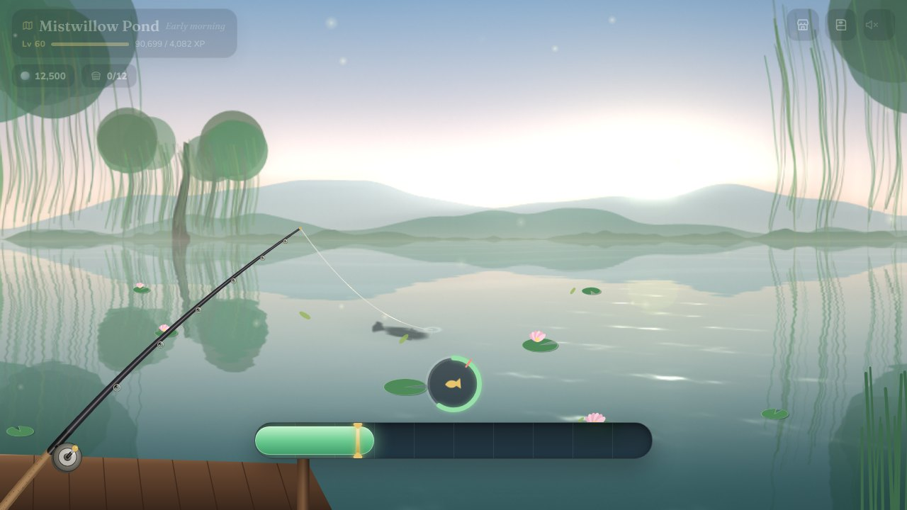
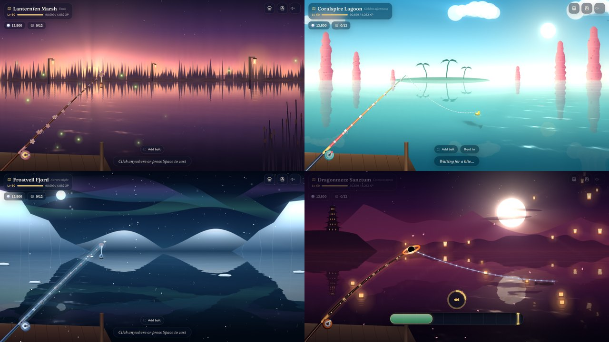
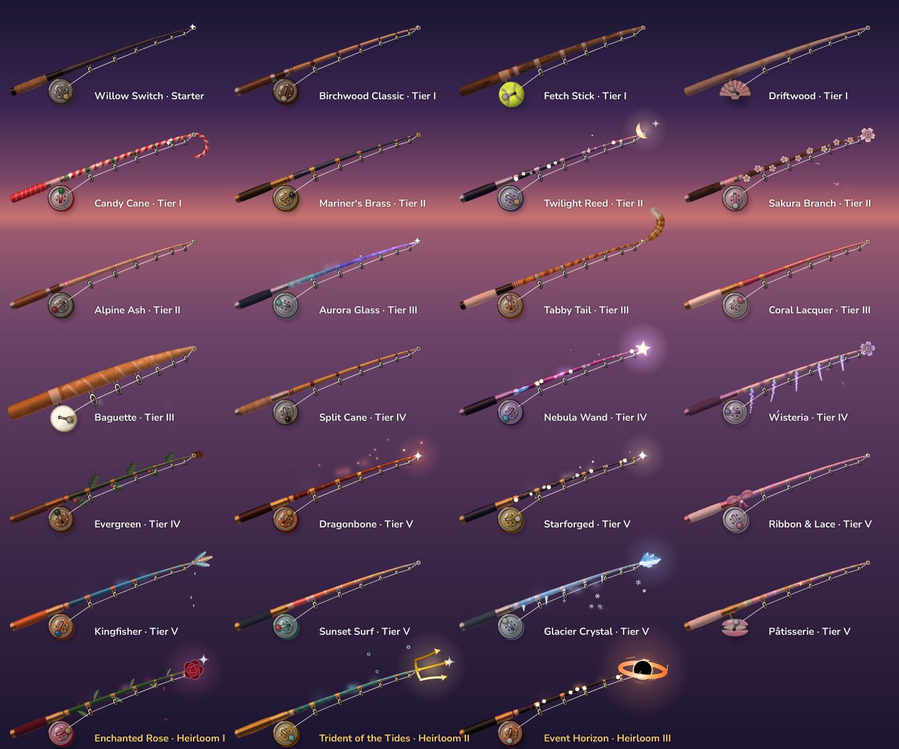
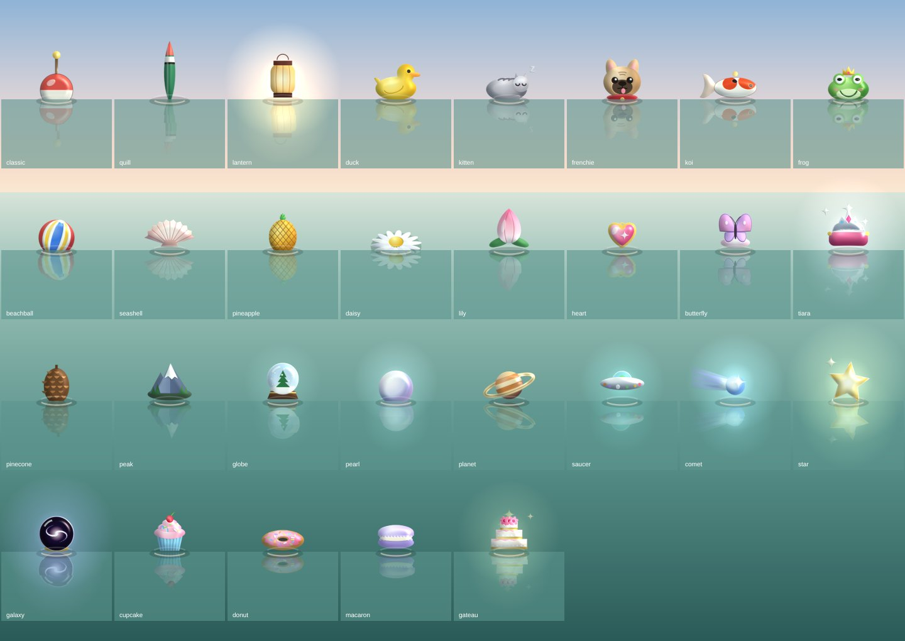
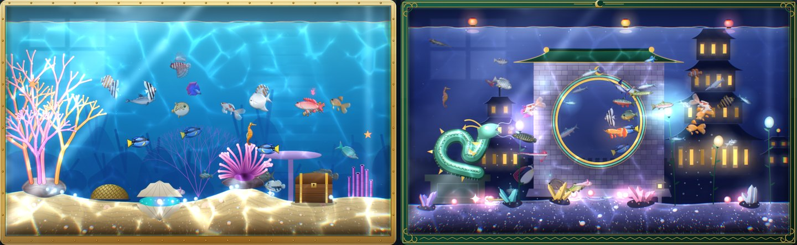
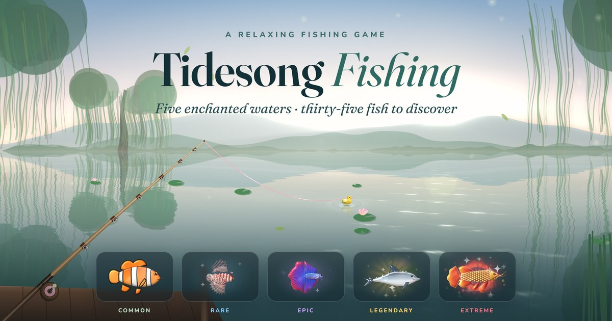

# Tidesong Fishing

A calm, hand-crafted fishing game for phone and desktop browsers. Cast into five enchanted waters,
wait for a bite, then hold to keep the gold fish marker inside your green band until the ring fills.



- **No build step, no server, no assets.** Open `index.html` and play. Every fish, rod and lake is
  drawn in code, and every sound is synthesised with the Web Audio API.
- **58 species** across five waters, from a pond Bluegill to a Bottlenose Dolphin and the elusive
  Dragon Fish.
- **WebGL water and lighting** with reflections, ripples, bloom and god rays, plus a 2D fallback for
  devices without WebGL.
- **A market of 88 pieces of gear** in seven themes on one tier ladder. Every tier offers several
  styles at the same price and boost, up to Heirloom pieces that take a whole career to save for.
- **A living aquarium** for the fish you keep: six tanks from a glass bowl to a moonlit palace, where
  fish explore, meet, make friends and sometimes mates, and the rarer ones leave pearls on the sand.
- **Progress saves automatically** in the browser.

## Contents

- [Playing](#playing)
- [How a catch works](#how-a-catch-works)
- [The five waters](#the-five-waters)
- [The fish](#the-fish)
- [The Driftwood Market](#the-driftwood-market)
- [The aquarium](#the-aquarium)
- [Graphics](#graphics)
- [Sound](#sound)
- [Project structure](#project-structure)
- [Tuning the game](#tuning-the-game)
- [Testing shortcuts](#testing-shortcuts)
- [Browser support](#browser-support)

## Playing

Open `index.html` in a modern browser. That's it: there is nothing to install or build.

To serve it locally instead (handy for testing on a phone on the same network):

```bash
python3 -m http.server 8000
```

Then visit `http://localhost:8000`.

| Action | Desktop | Phone |
| --- | --- | --- |
| Cast | Click anywhere, or press Space | Tap anywhere |
| Push the green band right | Hold the mouse button or Space | Hold anywhere |
| Let the band drift left | Release | Lift your finger |

## How a catch works

1. **Cast.** The float lands on the water.
2. **Wait.** Bites come on a rolling chance that grows the longer the line sits. A faint shadow
   circles the float and noses in on nibbles before it strikes.
3. **Fight.** A slider appears with a gold line (the fish) and a green band (your control). Hold to
   push the band right and release to let it drift left. While the gold line is inside the band, the
   ring fills. When it is outside, the ring drains. Fill the ring to land the fish. If it drops
   below the red mark, the fish gets away.
4. **Keep, sell or release.** Every catch has a weight, a length and a price.

A bite never announces its rarity: the cue, the shadow and the slider look the same for every fish.
You learn what you have hooked from how hard it fights. Rarer fish move faster, change direction
more often, dart across the slider and thrash in place.

| Rarity | XP | Base price | How it fights |
| --- | --- | --- | --- |
| Common | 10 | 12 | Steady, with long pauses |
| Rare | 28 | 45 | Quicker, with the odd dash |
| Epic | 75 | 160 | Darts and thrashes |
| Legendary | 320 | 1,200 | Fast and erratic |
| Extreme | 1,200 | 5,000 | Relentless |

The first catch of each species earns a discovery bonus.

## The five waters

Each water opens at a fishing level and has its own fish, odds, light, sounds and rare moments: a
frog hopping onto a lily pad, a gull sweeping past, dolphins leaping past the reef, a whale breaching
under the aurora.



| Water | Opens at | Time of day | Rarity odds per bite |
| --- | --- | --- | --- |
| Mistwillow Pond | Level 1 | Early morning | Common 87%, Rare 11%, Epic 2% |
| Lanternfen Marsh | Level 3 | Dusk | Common 78%, Rare 18%, Epic 4% |
| Coralspire Lagoon | Level 6 | Golden afternoon | Common 64%, Rare 26%, Epic 8.7%, Legendary 1.3% |
| Frostveil Fjord | Level 10 | Aurora night | Common 60%, Rare 27%, Epic 11%, Legendary 2% |
| Dragonmere Sanctum | Level 15 | Crimson moon | Common 52%, Rare 30%, Epic 14.6%, Legendary 2.8%, Extreme 0.6% |

## The fish

Fifty-eight species: 26 Common, 17 Rare, 12 Epic, 2 Legendary and 1 Extreme. Every water has its own
signature fish, and each species bites most often at its home water, so completing the journal means
fishing all five. The journal shows a silhouette of every fish you have not caught yet, with the
water where your odds are best.

| Water | Signature fish |
| --- | --- |
| Mistwillow Pond | Bluegill, Perch, Roach, Tench, Largemouth Bass, Longnose Gar, Angelfish, **Axolotl** |
| Lanternfen Marsh | Mudskipper, Lanternfish, Lyretail Killifish, Ghost Glassfish, Glowfen Eel, Archerfish, Paddlefish, Betta, **Anglerfish** |
| Coralspire Lagoon | Clownfish, Red Snapper, Blue Tang, Copperband Butterflyfish, Lionfish, Queen Parrotfish, Picasso Triggerfish, Golden Seahorse, Mandarinfish, **Dolphin** (Legendary) |
| Frostveil Fjord | Cod, Arctic Char, Herring, Sculpin, Sturgeon, Halibut, Wolffish, Oarfish, Crystal Icefish, **Penguin** (Legendary) |
| Dragonmere Sanctum | Temple Goldfish, Dojo Loach, Paradise Fish, Snakehead, Siamese Tigerfish, Swordfish, Flowerhorn, **Dragon Fish** (Extreme) |

Most signature fish are found only in their home water. You can fish your way through the five waters
quickly, but every one of them keeps something you will have missed, so the journal keeps calling you
back. On the map, each water's card lists its fish, with the ones you have not caught yet shown as "???".

<details>
<summary>All 58 species by rarity</summary>

| Rarity | Species |
| --- | --- |
| Common | Trout, Salmon, Pomfret, Catfish, Crucian, Tilapia, Carp, Bluegill, Perch, Roach, Tench, Mudskipper, Lanternfish, Killifish (Lyretail), Glassfish (Ghost), Clownfish, Red Snapper, Blue Tang, Butterflyfish (Copperband), Cod, Arctic Char, Herring, Sculpin, Goldfish, Loach (Dojo), Paradise Fish |
| Rare | Pufferfish, Grouper, Pike, Barracuda, Bass, Gar (Longnose), Eel, Archerfish, Paddlefish, Lionfish, Parrotfish (Queen), Triggerfish (Picasso), Sturgeon, Halibut, Wolffish, Snakehead, Tigerfish (Siamese) |
| Epic | Koi, Flying Fish (Sting Ray), Angelfish, Axolotl, Betta, Anglerfish, Seahorse, Mandarinfish, Oarfish, Icefish (Crystal), Swordfish, Flowerhorn |
| Legendary | Penguin (Emperor), Dolphin (Bottlenose) |
| Extreme | Dragon Fish (Arowana) |

</details>

Detail grows with rarity. Commons are clean and simple, rares gain fin rays and patterning, epics
gain flowing animated fins, and the Legendary and Extreme catches get the full treatment.


## The Driftwood Market

Sell fish for **Moonpearls** (the price grows with rarity, weight and length), either straight from
the catch screen or later from your aquarium, and spend them on:

- **Bait:** Glow Worms, Moon Shrimp and Ember Roe. One is used up on each bite. Bait tilts the odds
  toward Epic, Legendary and Extreme fish and brings bites sooner, but never guarantees them.
- **Rods, bobbers and lines:** 29 rods, 31 bobbers and 28 lines in seven themes (Classic, Cosmic,
  Blossom, Critters, Beach, Mountain and Bakery), from a dog-leash line and a French Bulldog float
  to a baguette rod with a wheel of brie for a reel. Each slot helps a different part of the fight:
  - **Rods** widen the green band.
  - **Bobbers** make the ring fill faster while the fish is in the band.
  - **Lines** slow the ring's drain when it slips out.
- **Aquariums:** six tanks, bought in order, from 8 fish up to 48. Each is more elaborate than the
  last (see [The aquarium](#the-aquarium)). A full tank means selling or releasing a fish before you
  can keep another.

Star a fish to protect it from "Sell all unstarred". Legendary and Extreme catches are starred
automatically.
The journal keeps lifetime records (counts, heaviest, longest, most valuable, rarest) even after
fish are sold.

### Gear tiers

All gear sits on one tier ladder shared by the three slots. Every piece on a tier costs the same and
gives the same boost, and most themes appear on most tiers. Every theme has a piece on
Tier V, so you can dress your kit in cosmic, bakery or critters style without giving anything up.
You can skip tiers, and a new piece is equipped straight away unless it is a step down from what you
already have on.

| Tier | Boost | Price | Choice of styles |
| --- | --- | --- | --- |
| Starter | none | free | Willow Switch, Classic Float, Clear Mono |
| Tier I | 2.5% | 250 | 4 rods, 5 bobbers, 5 lines |
| Tier II | 5% | 750 | 4 rods, 5 bobbers, 4 lines |
| Tier III | 7.5% | 2,000 | 4 rods, 5 bobbers, 4 lines |
| Tier IV | 10% | 5,000 | 4 rods, 5 bobbers, 4 lines |
| Tier V | 12.5% | 12,000 | 7 rods, 7 bobbers, 7 lines: one in every theme |
| Heirloom I | 15% | 36,000, from level 18 | Enchanted Rose, Grand Gâteau, Summit Rope |
| Heirloom II | 17.5% | 55,000, from level 22 | Trident of the Tides, Diamond Tiara, Diamond Leash |
| Heirloom III | 20% | 80,000, from level 26 | Event Horizon, Galaxy Orb, Constellation Thread |

The ladder and the Legendary and Extreme fights were tuned together in a simulation of whole
careers, with three models of human play (casual, steady and focused):

- The first upgrade comes within minutes, and early on a new piece is affordable every 5 to 15 minutes.
- For a steady player, Tier V in every slot takes about six and a half hours, and the Heirlooms are
  the long goal after that.
- Each tier makes common fights shorter and lifts the odds on the hardest fish. A steady player lands
  a Legendary about half the time with Tier II in every slot, and nearly every time from Tier IV.
- The Dragon Fish is the real test. A steady player lands it about a quarter of the time with a full
  Tier V kit and two thirds of the time with Heirloom I. Only a full Heirloom III kit makes it close
  to certain, and a casual player still finds it a challenge even then.

<p>
  
  
</p>

## The aquarium

Fish you keep live in an aquarium, opened from the bowl button under the place name. Tap a fish to
follow it with a card showing its weight, length, temperament and friendships, and to star, sell or
release it. **List** shows every fish, most valuable first; **Sell all unstarred** clears out the
rest; and **Feed** (once every 30 seconds) sprinkles flakes that every fish comes for, though
bottom-dwellers wait for them to sink.

| Tank | Fish | Price | What is in it |
| --- | --- | --- | --- |
| Glass Bowl | 8 | free | A round bowl on a windowsill at night: coloured glass pebbles and a sprig of green |
| Reed Tank | 12 | 200 | Swaying reeds, a hollow mossy log, an air stone and a snail crawling on the sand |
| Lily Garden | 16 | 500 | Lily pads and lotus overhead, a frog, a driftwood arch, rolling moss balls, a visiting dragonfly |
| Coral Reef | 24 | 1,200 | Branching corals, a sea fan, an anemone, a giant clam and a treasure chest, under bright sunbeams |
| Shipwreck Cove | 32 | 3,000 | A sunken ship in a kelp forest, a ship's bell, portholes, an anchor and a diver's helmet that breathes bubbles |
| Moon Palace | 48 | 7,500 | A moon gate, a stone dragon blowing bubble rings, lantern plants, singing geodes, glowing sand and floating lanterns |



The game explains almost none of what follows; players find it by watching and touching.

- **Every species has a temperament** (`TR` in `js/tank.js`): the depth it likes, its pace, and
  flags such as schooling, shy, playful, territorial, foraging, curious, glowing, lurking, upright
  or bottom-walking. These steer where it swims, which decor it visits and how it meets others.
- **Decor is lived in.** Shy fish slip into hiding places, foragers rummage in the sand, seahorses
  hold on to stems, clownfish nestle in the anemone, playful fish ride bubble streams, nudge moss
  balls along and swim through arches and gates, and fish brush plants aside as they pass.
- **Touch matters.** Each species reacts in its own way when tapped (pufferfish puff up, archerfish
  spit, dolphins loop and blow a ring, axolotls blush, flatfish bury themselves). Tapping the
  water draws curious fish and scatters shy ones, a finger trailed through the water is followed,
  and most decor does something when touched.
- **Fish meet.** When two fish come close they may greet, circle, swim together, play tag, boop,
  kiss, dance, flare at each other, or clean a larger fish, depending on who they are and how well
  they know each other.
- **Bonds.** Every pair has a bond from 0 to 100 that grows while they spend time near each other
  and with each meeting, faster for kin, for fish from the same waters, and for playful pairs, and
  slower for two territorial fish. While the tank is closed, each fish spends its hours with the
  few it gets on with best. Bonds show on a fish's card as Acquainted (20), Friends (50) and Best
  friends (80); friends seek each other out. Two of the same species who reach 100, both free,
  become **mates 💕** for life.
- **Moonpearls.** Rare and rarer fish now and then drop a pearl that sinks to the sand, more often
  if they are mated or have been fed in the last 15 minutes; tap it to collect it. Pearls keep
  dropping while the tank is closed (a long absence counts for at most four hours), until the sand
  holds `6 + 2 × tank` of them.
  A pearl glinting in the tank lights a dot on the tank button.

<details>
<summary>Spoilers: what each tank's decor does</summary>

- **Glass Bowl:** tapping the pebbles makes them hop; tapping the glass draws curious fish.
- **Reed Tank:** the air stone bursts and lifts playful fish to the surface; knocking on the log
  flushes out whoever is hiding in it; the snail, crawling along the sand, pulls into its shell.
- **Lily Garden:** pads bob, the frog croaks and hops to another pad, the dragonfly flies off (an
  archerfish will try to knock it down first), moss balls roll, and knocking the arch sends a few
  fish through it.
- **Coral Reef:** the anemone pulls in and its clownfish dive home; the clam snaps shut, but every
  three hours it holds a pearl; the chest opens, and every six hours it spills a few pearls.
- **Shipwreck Cove:** the bell turns every fish to look; portholes light up and draw a crowd; the
  helmet burps a column of bubbles; the chest holds pearls every five hours; the anchor clanks.
- **Moon Palace:** lanterns glow and draw glowing fish; the gate lights and leads a procession
  through it; the dragon blows a ring that playful fish swim through; the sand glows where fish
  graze it. Playing the five geodes left to right lights the whole palace, sets every fish spinning,
  and twice a day leaves a moon pearl.

</details>

## Graphics

The sky and water render in WebGL behind a 2D canvas:

- **Water:** perspective waves whose reflections distort more toward the foreground, ripple rings
  from casts, bites and splashes, and a glitter path under the sun or moon.
- **Light:** bloom on bright light, god rays, horizon haze, a vignette and dithering. Foliage
  sways in the wind.
- **The aurora** over Frostveil is drawn by the sky shader. Curtains of fine, shimmering rays hang
  from bright lower edges, fold across the sky and burn brighter where they fold. Each runs from
  green to violet, with slow pulses of light travelling along it. It blooms, mirrors in the water
  and casts a faint green light on the ice and the haze.
- **Fish:** each painted fish is lit as a three-dimensional material, with volume, specular
  highlights, rim light, iridescence, scale relief, caustics and a swimming wave.

Each water has its own light (direction, key and ambient colour, rim colour), and the gear and the
leaping fish are lit by it:

- **Rods** are shaded as cylinders: a shadow side, a highlight and a specular line that follow the
  light around the bend, a rim light at night, metal guides, and a reel with the equipped line wound
  on its spool.
- **Bobbers** share the fish's lighting engine, with a material each: plastic, wood, felt, paper,
  metal, pearl, glass or icing. On the water, the part below the waterline is tinted and wobbles
  through the water, with a broken reflection and a meniscus at the surface.
- **Lines** taper away from you, sway in the wind and carry glints that run along them.
- **The fish below** is drawn by the water shader, under the surface: bent by the waves, softer
  when deep and seen through the reflections. It is the same shape for every fish.

Phones render the scene at reduced resolution, and a governor lowers it further if the frame rate
drops. Without WebGL, or with `#nogl` in the URL, the game falls back to a 2D renderer.

### The aquariums

Each tank is painted on a 2D canvas (`js/tank-env.js` for the scenery, `js/tank.js` for the fish)
and then lit on the GPU by `js/tank-gl.js`:

- **Water:** caustics that fall hardest on the sand and decor and dapple the fish as they pass, a
  faint shimmer that is strongest just under the surface, and light shafts scattered from the bright
  water at the top, so fish and leaves near the surface throw shadows down the beams. Bright
  things (lanterns, pearls, glints) bloom.
- **Glass:** the thick edge of each pane doubles the picture and turns it faintly green, colour
  fringes grow toward the edges, the polished edge catches the light, and soft reflections and
  smudges drift as the pointer moves. The round bowl is a lens: its middle swells and its sides
  crowd toward the rim (taps are mapped through it, so a tap lands on the fish you see).
- **The Glass Bowl's room:** the moon's path glitters on the lake outside, stars twinkle, a cloud
  drifts past the moon, the shore's lights shiver in the water, a sheer curtain breathes, the
  lamp flickers, moonbeams slant in with dust turning in them, and the bowl throws rippling light
  on the sill. The moon's rays scatter across the room.
- **Scenery:** plants are ribbons, kelp blades, whorled stems and fans, shaded from root to
  sunlit tip; plants at the back fade into the water's colour. Each plant rides a soft spring, so a
  passing fish leans it gently aside and it sways back. Planted tanks bead tiny oxygen bubbles from
  leaf tips, and motes drift in the water.

Without WebGL (or with `#nogl`) the tanks keep their 2D light shafts, caustics and glass. Like the
lake, a tank that keeps missing about 38 frames a second renders at a lower resolution.

### Interface

The interface is made of four materials, lit from above like the scenes, so it feels set into the
world rather than laid over it:

- **Slabs** of frosted glass with a bevelled edge and a faint grain hold the HUD, the prompt and
  the cards.
- **Wells** are shallow carved recesses, shadowed under their top lip and catching light along
  their bottom edge: the reel track, bars, stat cells and the panels inside cards.
- **Pebbles** are smooth raised stone buttons that sink into a well when pressed.
- **Brass** marks the main actions, with engraved lettering. Anything you cannot afford yet dulls
  and sits back into the stone.

The reel track is a groove with etched graduations, the green band a piece of polished jade, the
fish a gilded needle, and the catch ring a groove cut into a stone disc.

## Sound

All sound is synthesised at runtime with the Web Audio API: there are no audio files. It is
built to feel natural rather than electronic:

- **Soft instruments:** musical notes are a physically modelled plucked string (Karplus–Strong,
  plucked from a triangle shape like a fingered harp string, with a round body under it),
  bells and chimes are modal (a few decaying partials, the higher ones dying first), and noise is
  pink or brown rather than harsh white noise. Every envelope is smooth, so nothing clicks.
- **Real-sounding water:** drops and splashes are clusters of tiny bubbles whose pitch rises as they
  ring, as real bubbles do. Small waves lap the bank, surf gathers, breaks and washes back, and
  droplets patter down after a splash.
- **Living creatures:** frogs and gulls are a pulsing voice shaped by throat formants, crickets are a
  tone gated into chirps of pulses, songbirds sing phrases of rising chirps, slurs and trills, and a
  dove coos across the pond.
- **A space for every water:** each one has its own generated reverb, from the open air of
  Coralspire to the cliff echoes of Frostveil and the long temple ring of Dragonmere.
- **Scenes that dissolve into each other:** travelling muffles the old water and lets it drift into
  its own echo while the new one opens up, and the reverb itself crossfades.
- **A living backdrop:** a quiet chord breathes under each scene and moves to a new chord every
  twenty seconds or so, one voice at a time.
- **The fight:** you hear the water churned up by the fish, panned to where it pulls; the line
  humming under strain when the fish is outside the band; the reel's ratchet clicking in an even
"trrrr" as you wind (real metallic clicks scheduled ahead on the audio clock at the spool's rate, so
they never stutter), coasting down when you let go and clicking faster as drag when the fish runs; a harp
  climbing the pentatonic scale as the ring fills; and a soft heartbeat when the fish is about to
  escape.
- **Gear with a voice of its own:** almost every rod, bobber and line sounds different, and the
  market never says how. A line sings as it flies out on the cast, a bobber announces itself as it
  lands, and a rod's reel turns with its own ratchet. Equip something new and listen. The starter
  kit keeps the plain sounds.

| Water | Soundscape |
| --- | --- |
| Mistwillow Pond | Songbirds, a cooing dove, willow leaves stirring, fish rising |
| Lanternfen Marsh | Cricket chorus, frogs calling and answering, marsh bubbles |
| Coralspire Lagoon | Surf on the reef, distant gulls, palms in the breeze |
| Frostveil Fjord | Howling wind, ice chimes, groaning and singing ice, the aurora's hum |
| Dragonmere Sanctum | Temple wind chimes, a far-off temple bell, crackling lanterns |

A master chain softens the top end and glues everything with a gentle compressor and limiter.
Sound can be muted from the top bar.

## Project structure

```text
index.html          Page markup and all styling (HUD, reel slider and ring, panels)
js/
  data.js           Rarities, species, the five waters and their odds, reel tuning, XP curve
  audio.js          Synthesised sound: instruments, water, creatures, spaces, ambience and the fight
  voices.js         The gear's own voices: each line's cast, each bobber's landing, each rod's reel
  fish-art.js       Procedural drawings of all 58 species and their rarity auras
  fish-gl.js        WebGL lighting engine for painted sprites (fish and bobbers)
  flourish.js       Rare per-water moments (frog, gull, dolphins, owl, whale, dragon and more)
  scenes.js         The five painted, animated waters and each water's light
  water-gl.js       WebGL sky and water, underwater fish shadow, bloom, god rays, haze
  gear.js           Rod, bobber and line catalogue, and the code that draws and lights each one
  ui.js             Interface motion: cards glide to new sizes and new sections slide in
  shop.js           The Driftwood Market: bait, gear and aquariums
  tank-env.js       The six aquariums: glass, water, sand, plants and decor that can be touched
  tank-gl.js        The aquariums' light and glass on the GPU: caustics, shafts, bloom, lensing, glass
  tank.js           The aquarium's life: swimming, temperaments, meetings, bonds, pearls, feeding
  game.js           Game loop, cast, bite, reel and catch logic, input, saving, map and journal
docs/
  social-preview.jpg  The 1200×630 banner shown when the site's link is shared
  screenshots/        Images used in this README
```

### Link previews

`index.html` carries Open Graph and Twitter card tags, so a shared link to the hosted site
(`https://vuvrtroopers.github.io/tidesong-fishing/`) shows a title, a short description and the
banner in `docs/social-preview.jpg`. If the site moves, update the absolute URLs in those tags.



### Scripts and saves

Scripts load in the order above as plain `<script>` tags, and each file exposes one global
(`FishArt`, `WaterGL`, `Gear` and so on). Saves are stored in `localStorage` under
`tidesong.save.v1`.

## Tuning the game

Most balance lives in `js/data.js`:

| What | Where |
| --- | --- |
| Bite odds per water | `LOCATIONS[].rarity` (which rarity bites) and `LOCATIONS[].fish` (which species) |
| Unlock levels and XP curve | `LOCATIONS[].level` and `xpForLevel()` |
| Fight difficulty | `REEL`, per rarity: fill and drain rates, band width, and how fast and erratically the fish moves |
| Band feel | `BAND_PHYS`: acceleration while holding, sink speed, drag |
| The ring | `REEL_START` (starting fill), `REEL_ESCAPE` (the red mark), `REEL_GRACE` |
| Fish prices | `VALUE` (base price per rarity) and each species' `worth`, `kg` and `cm` ranges |
| Bait | `BAITS`: pack size, price, odds boost per rarity, bite speed-up |
| Aquarium sizes and prices | `TANKS` |

The gear tier ladder (boost, price and level for each tier) is `TIERS` at the top of `js/gear.js`.
Each piece in the catalogue below it names its theme and tier and takes everything else from the
ladder. If you change the ladder, retune the Legendary and Extreme rows of `REEL` with it. Each water's colours and light are in `PAL` in
`js/scenes.js`.

In `js/tank.js`, `TR` holds each species' temperament, `PEARL` the pearl interval and value per
rarity, and `affinity()` how readily two fish bond.

## Testing shortcuts

Add `#dev` to the URL to unlock every water, jump to level 26 (so Heirloom gear can be bought) and
show buttons that choose the rarity of the next bite or grant 50,000 Moonpearls.

In the browser console:

| Command | Effect |
| --- | --- |
| `Tidesong.hook('dolphin')` | The next bite is that species (any id from `SPECIES`) |
| `Tidesong.hookRarity('epic')` | The next bite is a random species of that rarity |
| `Tidesong.addXp(500)` | Grants XP |
| `Tidesong.addPearls(1000)` | Grants Moonpearls |
| `Tidesong.flourish('frog')` | Plays a water's rare moment now: `frog`, `dragonfly`, `fishjump`, `owl`, `wisp`, `gull`, `dolphins`, `shootingstar`, `whale`, `crane` or `dragon` (at the matching water) |
| `Tank._debug.feed()` | Feeds the open aquarium (it has the same 30-second cooldown as the button) |
| `Tank.settle(Date.now() + 6 * 3600e3)` | Lets six hours pass for the tank (pearls and bonds), then open it |
| `Tidesong.reset()` | Wipes the save |

## Browser support

Current versions of Chrome, Edge, Firefox and Safari, on desktop, Android and iOS. WebGL is used
where available, and the game falls back to its 2D renderer when it isn't.
